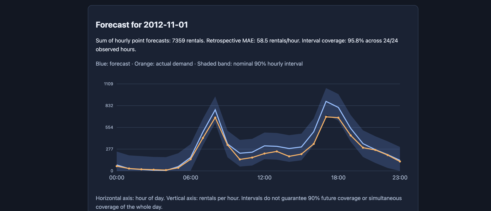

# Demand Forecast Lab

[](https://github.com/PremKalyanDavidRaj/demand-forecast-lab/actions/workflows/tests.yml)

A historical bike-rental forecasting application with chronological
evaluation, empirical prediction intervals, a FastAPI service, and an
interactive browser dashboard.

The project compares gradient boosting with a seasonal baseline and
deploys the approach selected by validation mean absolute error.

## Browser demo



Select a historical date to display:

- 24 hourly demand forecasts.
- Nominal 90% hourly prediction intervals.
- Actual recorded demand where available.
- The selected day's MAE and interval coverage.
- The historical source used for each prediction.

The application uses historical data, not a live demand feed.

## Model comparison

Validation period: July–August 2012.

| Approach | MAE | RMSE |
| --- | ---: | ---: |
| Same-hour-last-week baseline | 53.213 | 90.396 |
| Gradient boosting trained on 2012 history | 59.177 | 84.236 |
| Gradient boosting correcting weekly residuals | 62.307 | 87.830 |
| Gradient boosting trained on all training history | 68.148 | 93.014 |

The weekly baseline was selected using the predefined validation MAE
criterion. The recent-history model had lower RMSE but higher MAE.

If the weekly historical count is missing, the selected approach uses
the same hour yesterday, then the training target median.

## Final test results

Test period: November–December 2012.

| Metric | Result |
| --- | ---: |
| MAE | 73.399 rentals/hour |
| RMSE | 120.071 rentals/hour |
| Nominal hourly interval coverage | 90% |
| Observed hourly interval coverage | 86.85% |
| Mean interval width | 286.94 rentals/hour |
| Observed target hours evaluated | 1,460 |
| Missing target hours excluded | 4 |

The intervals undercovered relative to their nominal target.
These results are reported without retuning on the test period.

Weekly history was missing for 39 evaluated hours. The yesterday
fallback covered these cases; the training-median fallback was not used.

Full results and provenance hashes are in reports/test_metrics.json.

## Forecast design

Forecasts are issued at the start of each calendar day, assuming all
recorded prior-day counts are available.

Historical lags are 24, 48, 168, and 336 hours. Calendar features and
these lags were used in the gradient-boosting experiments. The selected
baseline uses the 168-hour lag with the documented fallbacks.

The service masks forecast-day and future observations before building
features. Actual observations are served separately for retrospective
comparison.

Evaluation uses daily rolling forecast origins. Earlier observed test
counts may become history for later test days, while the forecasting
rule and interval margin remain fixed.

## Data splits

| Split | Period | Purpose |
| --- | --- | --- |
| Training | Before July 2012 | Model fitting |
| Validation | July–August 2012 | Approach selection |
| Calibration | September–October 2012 | Interval margin estimation |
| Test | November–December 2012 | Final evaluation |

The hourly timeline is reindexed before creating lags.
Absent rental counts remain missing; they are not assumed to be zero.

Same-hour casual and registered counts are excluded because they sum
to the target. Future observed weather is also excluded.

## Prediction intervals

The interval margin is the 90th percentile of absolute calibration
errors, using NumPy's higher quantile method.

Intervals use prediction ± margin, with lower bounds clipped at zero.
The calibrated margin for this run was 170 rentals/hour.

Coverage is pooled across individual hours. It is not a guarantee for
each hour, a whole day, or future deployments. Temporal dependence
and changing demand patterns can affect coverage.

## Setup

Developed with Python 3.13.1.

```bash
python3 -m venv .venv
source .venv/bin/activate
python -m pip install -r requirements.txt
```

requirements-lock.txt records a development environment snapshot.
Its portability to other platforms has not been established.

## Reproduce the workflow

Run from the repository root:

```bash
python scripts/download_data.py
python scripts/audit_data.py
python scripts/prepare_data.py
python -m scripts.build_features
python -m scripts.train
python -m scripts.compare_models
python -m scripts.select_model
python -m scripts.calibrate
python -m scripts.evaluate_test
```

The selection script currently expects the weekly baseline to win.
It stops if the comparison produces a different winner.

Generated data and model artifacts are excluded from Git.
Download metadata, hashes, and evaluation reports are tracked.

## Run the application

```bash
source .venv/bin/activate
python -m uvicorn src.api:app --host 127.0.0.1 --port 8005
```

- Dashboard: http://127.0.0.1:8005/demo
- API documentation: http://127.0.0.1:8005/docs
- Health: http://127.0.0.1:8005/health

Example:

```bash
curl -sS http://127.0.0.1:8005/forecast \
  -H "Content-Type: application/json" \
  -d '{"forecast_date":"2012-11-01"}'
```

Available forecast dates are November 1, 2012 through January 1, 2013.
January 1 forecasts use the available history, but no actual observations
for that day exist in this dataset.

## Tests

```bash
python -m pytest -q
```

Tests cover forecast-time feature isolation, exact hourly lags,
missing values, fallback ordering, and interval bounds.

## Dataset

Fanaee-T, H. (2013). Bike Sharing [Dataset].
UCI Machine Learning Repository.
https://doi.org/10.24432/C5W894

Licensed under CC BY 4.0. See DATASET.md.

## Limitations

- Historical data from one bike-sharing system.
- No live ingestion or operational deployment.
- Timestamp labels are used without timezone conversion.
- Prior-day count availability is assumed.
- Missing target hours are excluded from reported metrics.
- Interval coverage fell below the nominal target on the final test.
- Dashboard daily metrics do not represent full-period performance.
- The local demo does not implement authentication or production load testing.
